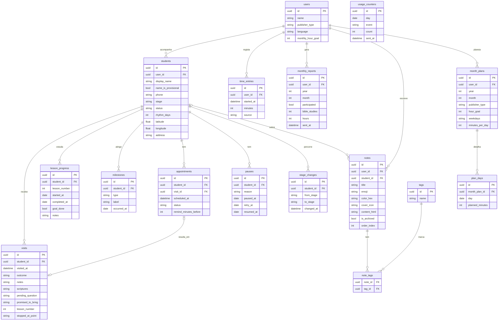

# Modelo e fluxos de dados

A versão 1 usa 17 tabelas no SQLite do telemóvel, com a tabela `students` no centro. Nenhum dado pessoal sai do dispositivo sem uma acção do utilizador.

## Modelo de dados

| Tabela | O que guarda | Serve |
| --- | --- | --- |
| `users` | Perfil local: perfil, língua e meta mensal de horas | Todas |
| `students` | Cada estudante acompanhado: contacto, etapa, estado, ritmo e localização | P1, P5, P7, P10 |
| `visits` | Cada visita ou tentativa, com notas, dúvida pendente, o que ficou prometido, a lição e o ponto onde pararam | P2, P8 |
| `lesson_progress` | Uma linha por lição iniciada, com início, conclusão e "Tente o seguinte" | P3 |
| `milestones` | Marcos: primeira reunião, primeiro comentário, revisões de parte, batismo | P1 |
| `stage_changes` | Histórico de mudanças de etapa | P12 |
| `appointments` | Visitas agendadas e lembretes | P4, P6 |
| `pauses` | Pausas com motivo e data para tentar de novo | P9 |
| `time_entries` | Horas do cronómetro ou manuais | S4, S9 |
| month\_plans | Plano do mês do pioneiro: tipo e meta desse mês, dias da semana em que conta sair e horas por dia | S4 |
| plan\_days | Cada dia planeado do mês, com as horas previstas, que o utilizador pode acertar | S4 |
| `monthly_reports` | Relatório de cada mês, no formato novo | S2, S3 |
| `notes` | Anotações (implementadas): texto rico, emoji, cor, capa, arquivo e etiquetas (tabelas tags e note\_tags), com ligação opcional a um estudante | S6 |
| `usage_counters` | Contagens anónimas de uso, sem ligação a ninguém | Medição de uso |

## Regras do modelo

**Colunas comuns.** Todas as tabelas, excepto `usage_counters`, têm também `created_at`, `updated_at`, `deleted_at` e `sync_status`. Os identificadores são UUID gerados no telemóvel. É isto que prepara a sincronização da versão 2.

**Valores fixos.**

| Coluna | Valores |
| --- | --- |
| `students.stage` | `first_contact`, `return_visit`, `study_started`, `regular_study`, `unbaptized_publisher`, `baptized` |
| `students.status` | `active`, `paused`, `closed` |
| `visits.outcome` | `met`, `not_home`, `rescheduled` |
| `appointments.status` | `pending`, `done`, `postponed`, `cancelled` |
| `users.publisher_type` | `publisher`, `auxiliary_pioneer`, `regular_pioneer`, special\_pioneer, missionary |
| `time_entries.source` | `timer`, `manual` |

**Uma só tabela de estudantes.** Do primeiro contacto ao batismo, todos ficam em `students`. O que os distingue é a etapa, por isso ninguém muda de tabela ao progredir.

**Tentativas falhadas são visitas.** "Não estava em casa" é uma linha em `visits` com `outcome = not_home`.

**Lições e visitas.**

1. Uma lição pode levar várias visitas. Cada visita guarda em `lesson_number` a lição onde pararam e, se o utilizador quiser, o ponto em `stopped_at_point`.
2. A primeira visita de uma lição cria a linha em `lesson_progress`, com `started_at` preenchido e `completed_at` vazio.
3. Quando uma visita regista uma lição mais avançada, o app faz duas marcações: fecha a lição anterior com a data da visita e abre a nova. Mostra uma confirmação com opção de desfazer.
4. `goal_done` nunca é automático. Só o utilizador sabe se o estudante cumpriu o "Tente o seguinte".
5. Se a lição saltar mais de uma, o app pergunta se as lições intermédias também foram concluídas.
6. O número de sessões por lição calcula-se contando as visitas com esse `lesson_number`.

**Plano do pioneiro.**

1. Há uma linha em `month_plans` por mês, só para pioneiros. Guarda `publisher_type` e `hour_goal` desse mês, porque o tipo e a meta podem mudar de um mês para o outro. `users` fica com os valores por omissão.
2. `weekdays` guarda os dias da semana escolhidos, de 1 (segunda) a 7 (domingo), separados por vírgula. `minutes_per_day` é o tempo previsto para cada um.
3. Ao guardar o plano, o app cria uma linha em `plan_days` por cada dia que falta no mês. O utilizador pode acertar `planned_minutes` dia a dia.
4. Mudar o plano a meio do mês recria só os dias futuros. Os dias passados ficam como estavam.
5. Horas feitas, horas em falta e "em cada dia planeado" não se guardam. Calculam-se de `time_entries`, `hour_goal` e `plan_days`.
6. A meta do ano de serviço do pioneiro regular continua em `users.yearly_hour_goal`. O ano de serviço vai de Setembro a Agosto.

## Do código actual ao modelo novo

A branch `dev` tem oito tabelas. Quatro mudam, quatro ficam como estão e nove são novas. Os identificadores já são UUID, por isso não há migração de chaves.

| Tabela actual | Passa a ser | O que muda |
| --- | --- | --- |
| `user` | `users` | `profile` passa a `publisher_type`, com os tipos novos. Acrescenta `language` e a meta mensal. Mantém `username` e `avatar_image` |
| `students` | `students` | `name` passa a `display_name`. Acrescenta `name_is_provisional`, `stage`, `status`, `rhythm_days`, `latitude` e `longitude`. `age` e `gender` deixam de ser obrigatórios. Mantém `about`, `telephone`, `email` e `address` |
| `visits` | `visits` | `students_id` passa a `student_id`, `date_and_hours` a `visited_at`, `biblical_texts` a `scriptures` e `result` a `outcome` com valores fixos. Acrescenta `pending_question`, `promised_to_bring`, `lesson_number` e `stopped_at_point`. Mantém `publications` |
| `student_availabilities` | `student_availabilities` | Fica como está. Continua a guardar os dias, a hora e o lembrete semanal de cada estudante |
| `reports` | `time_entries` | Hoje guarda um registo por dia, com horas, minutos e número de estudantes. As horas passam para `time_entries`. O número de estudantes deixa de ser escrito à mão e calcula-se das visitas |
| `notes` | `notes` | Fica como está. Acrescenta `student_id` opcional |
| `tags` | `tags` | Fica como está |
| `note_tags` | `note_tags` | Fica como está |

Tabelas novas: `lesson_progress`, `milestones`, `stage_changes`, `appointments`, `pauses`, `monthly_reports`, `month_plans`, `plan_days` e `usage_counters`.

Colunas comuns: só `notes` tem hoje `updated_at`, `deleted_at` e `sync_status`. As outras tabelas precisam das três.

## Fluxos de dados

&#91;embedded content: fluxo de dados · 1 origem, 3 passos no app, 6 destinos\]

Tudo o que o utilizador escreve fica no SQLite do telemóvel, e os ecrãs são calculados a partir daí, sem servidor.

| Destino | O que sai | Quando | Versão |
| --- | --- | --- | --- |
| Ficheiro de backup | Todas as tabelas, num ficheiro protegido | Quando o utilizador exporta ou restaura | 1 |
| Contagens anónimas | Só `usage_counters`: dia, tipo de evento e quantidade | Com autorização, quando há internet | 1 |
| Notificações locais | Nome do estudante e hora da visita, sem sair do telemóvel | Lembretes e alertas por ritmo | 1 |
| Relatório em texto | Participação, número de estudos e horas do mês | Quando o utilizador partilha | 1 |
| Google Maps | Latitude e longitude de uma casa | Quando o utilizador pede direcções | 1 |
| Sincronização cifrada | Todas as tabelas, com campos pessoais e notas cifrados no telemóvel | Com conta, em segundo plano | 2 |
